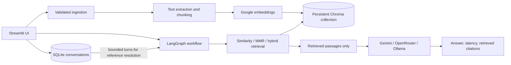

# GroundedIQ RAG Chatbot Architecture

`ingest.py` is a supported batch-indexing CLI for PDF, TXT, DOCX, and CSV files. `rag_graph.py` is a small interactive chat CLI over the configured Chroma collection; the Streamlit app remains the primary user interface. Both entry points are compiled in CI.

## Decisions

- The existing `chroma_db/` path and `pdf_documents` collection name are retained to keep prior indexed PDFs readable. The existing Google embedding model remains the default because vector dimensions and semantics must not be mixed.
- Ingestion extracts per-page PDF text, text paragraphs, Word paragraphs/tables, and CSV rows. Chunks include safe source filename, content hash, embedding model, and available page/row/section metadata. On same-name replacement, new text is extracted first, then prior chunks are replaced.
- Conversation history is stored in local SQLite. A bounded recent window can inform a rewrite query, but the final model receives document passages as the only factual evidence.
- Citations are generated from the exact retrieved `Document` objects. A no-passage result bypasses generation.
- Hybrid retrieval uses the Chroma semantic ranking plus BM25 over a candidate pool and reciprocal-rank fusion. MMR is offered for diversity. Relevance thresholds and reranking are omitted because the current integration does not expose comparable scores reliably and no reranker is installed.
- File deletion resolves paths and only unlinks direct children of the configured `documents/` folder. Index deletion targets only the configured collection.
- Fresh-start controls distinguish deleting the collection (keeping the Chroma folder) from deleting the entire configured `chroma_db/` directory. The directory removal helper validates its resolved path against the repository root and closes its SQLite client before unlinking files.
- Retrieval evaluation has no bundled corpus-specific labels. Users add questions and expected source/page labels in `rag_app/evaluation.py` after indexing their own files. Recall@k and reciprocal rank measure retrieval only, not answer accuracy; answer quality requires human review against retrieved passages.
- `.gitignore` and `.dockerignore` exclude secrets, uploads, local databases, vector data, and generated caches. The Docker image creates empty data directories at runtime, while `.env.example` remains available as a safe template.
