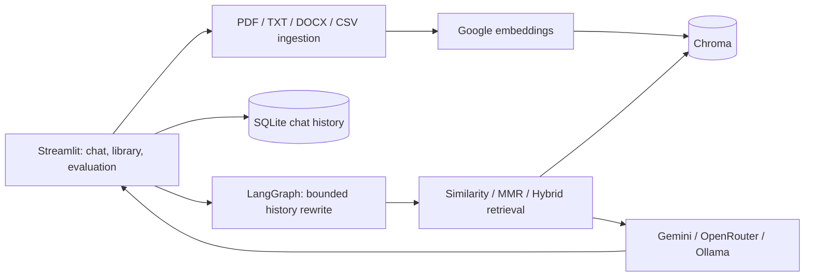

# GroundedIQ RAG Chatbot

*Conversational Document Intelligence*

A local-first, conversational RAG portfolio project built with Streamlit, LangGraph, Google embeddings, and Chroma. It ingests PDFs, text files, Word documents, and CSVs, stores named conversations in SQLite, and exposes the passages behind each answer.

## Architecture



See [ARCHITECTURE.md](ARCHITECTURE.md) for the conversational flow and key design choices.

## Setup

Python 3.11+ is required by the supported Streamlit version. On Windows PowerShell:

```powershell
python -m venv .venv
.\.venv\Scripts\Activate.ps1
python -m pip install --upgrade pip
python -m pip install -r requirements.txt
python -m streamlit run app.py
```

On macOS/Linux, create and activate a venv with `python3 -m venv .venv` and `source .venv/bin/activate`, then install requirements and run `python -m streamlit run app.py`. Virtual environments contain path-specific launchers: if you move or rename this project folder, recreate `.venv` from the new folder before starting the app.

Set `GOOGLE_API_KEY` and optionally `OPENROUTER_API_KEY` in the environment or `.streamlit/secrets.toml`, or enter them into the app sidebar for the active session. `.env` and Streamlit secrets files are ignored. Keys are never saved in SQLite or logged. A Google key is required for embeddings/retrieval and Gemini generation; OpenRouter needs its own key; Ollama needs no key. Avoid `.env` on shared machines.

## Supported features

- **Files:** PDF, TXT, DOCX, CSV; 25 MB per upload. Page, row, or section metadata is retained where available. OCR is not part of normal ingestion.
- **Generation:** Gemini, OpenRouter, Ollama. Configure provider, model, and temperature in the sidebar.
- **Retrieval:** configurable count; similarity, MMR for diversity, or hybrid semantic+BM25 reciprocal-rank fusion. The app does not apply an uncalibrated relevance cutoff or claim reranking. Compare strategies on the same query in the sidebar.
- **Chat:** named SQLite conversations, rename/delete/new chat, bounded recent history for standalone retrieval-query rewriting, and retrieved-only source citations with excerpts and latency.
- **Lifecycle:** inspect indexed files, process local uploads, reindex, remove vectors while retaining the upload, or delete a local upload while retaining vectors. “Start fresh” separately confirms upload deletion, collection clearing while preserving the database folder, full deletion of the `chroma_db/` folder, or combined upload/database deletion. Chat history and keys are unaffected.

The Chroma path and `pdf_documents` collection name intentionally match the earlier app so existing vectors remain recoverable. The configured embedding model is `gemini-embedding-001`; changing it requires a distinct collection and full reindex. Metadata from older chunks may not include newer fields.

## Demo flow

1. Start the app and enter a Google key in the sidebar.
2. In **Library & indexing**, upload any document you want to explore: PDF, TXT, DOCX, or CSV (up to 25 MB each). You can upload one file or several; the app does not require a bundled demo document.
3. Select **Index selected files**, then open **Chat**. Try “Summarize the key points,” inspect the source passages, and ask a follow-up about something in the answer.
4. Switch between Similarity, MMR, and Hybrid to compare retrieved passages from your own files.
5. Open Library & indexing to manage your documents or use the explicitly confirmed fresh-start controls.

## Evaluation and checks

The Evaluation tab starts with an empty, explanatory result because there is no universal set of expected answers for arbitrary user files. After indexing your own documents, edit `EVALUATION_CASES` in `rag_app/evaluation.py`. Add one entry per question with the exact indexed filename as `expected_source`, and use `expected_page` for a specific page or `None` when any page is acceptable. Include an optional `review` prompt to remind reviewers what evidence to check. The interface reports Recall@k and reciprocal rank (the mean reciprocal rank row) for retrieval only. These metrics measure whether expected source/page labels were retrieved; they do not measure generated answer accuracy. Review answers against the displayed passages yourself; no LLM judge is run.

Run the CLI against a single supported file or a folder containing supported files:

```powershell
python ingest.py path\to\report.pdf
python ingest.py documents
```

It supports the same PDF, TXT, DOCX, and CSV formats as the app. It uses `GOOGLE_API_KEY` from the environment or prompts for the key. `rag_graph.py` is an interactive command-line chat entry point; it asks for a Google key, then accepts a question against the configured index.

```powershell
python -m compileall -q app.py ingest.py rag_graph.py rag_app tests
python -m pytest -q
```

## Optional Ollama and OCR

For local generation, install Ollama separately, start its local service, run `ollama pull llama3.2:3b`, then select Ollama in the app. Model files are not included here.

OCR is intentionally not an ingestion requirement. To index a scanned PDF, install Tesseract and a compatible language pack separately, OCR the file externally into a searchable PDF, then upload that file. A missing text layer receives a friendly extraction error; the app does not silently call an external engine.

## Deployment notes and limits

Build with `docker build -t groundediq-rag-chatbot .` and run with a persistent volume mounted at `/app/chroma_db` and `/app/documents`; provide keys as runtime environment variables. The `.dockerignore` keeps credentials, local uploads, local databases, caches, and generated data out of the build context; the image creates empty data directories at runtime. Keep `.env.example` as the shareable configuration template and never add real keys or private files to an image. The included GitHub Actions workflow installs dependencies, compiles modules (including the CLI entry points), and runs mock-based tests without provider credentials. SQLite and Chroma are single-instance local persistence choices; use managed databases and access controls for multi-user production. The application has no authentication layer, and cloud providers receive prompts and retrieved excerpts when used. Documents are untrusted input; the workflow instructs the model not to follow embedded directions, but prompt injection defenses are not a formal security boundary.
